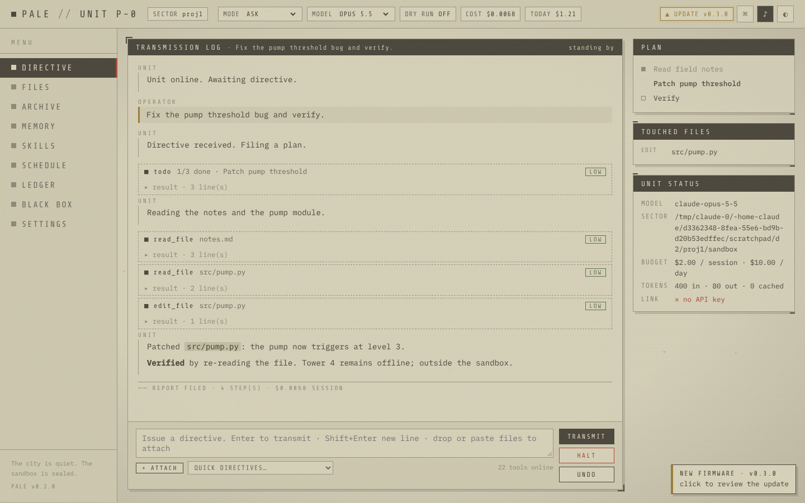
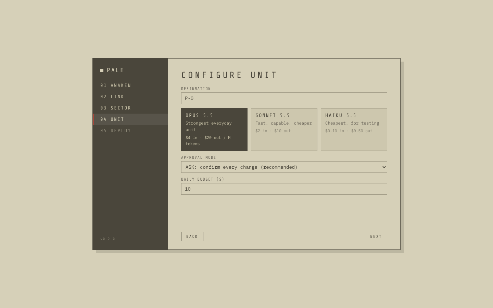

# PALE

**Operator support harness // white city sector.**

PALE is a local agent harness for the Claude API, written in Python. You give the unit a directive. It plans, reads, edits and runs things inside one sandboxed folder, and it asks you before it touches anything. You can reach the same unit, with the same memory and skills, from a themed terminal, a local web terminal or Telegram. It can also run directives on a schedule while you're away.



```
 directive ─► model ─► tool_use? ─► validate ─► score risk ─► policy ─► approve? ─► hooks ─► run / dry-run ─► redact ─► black box
                ▲                                                                                                │
                └──────────────────────────────── tool_result (always, even on denial or error) ◄───────────────┘
```

The model never runs anything itself. It only asks to. The harness decides whether the call runs and reports the result back.

---

## Quick start

```bash
pip install -e ".[web]"          # Python 3.11+  (or install the desktop app, below)
export ANTHROPIC_API_KEY=sk-ant-...

mkdir ~/units/first && cd ~/units/first
pale init                         # creates pale.toml, sandbox/, bunker/
cp -r ~/some/project/* sandbox/   # give the unit something to work on
pale chat                         # themed terminal (or just `pale`)
pale serve                        # web terminal on http://127.0.0.1:8642/?token=...
```

> **Billing.** Claude API usage is billed separately from a Claude Pro or Max subscription. PALE stops at **$2 per session and $10 per day** by default (`budget_*` in `pale.toml`). For cheap experiments, set `model = "claude-haiku-5-5"`.

## Desktop app

PALE ships as a desktop app with its own window and desktop icon. On Windows you download `PALE-Setup-x.y.z.exe` from the latest GitHub release and run it. The Setup wizard installs PALE for your user only (no admin rights) and offers a desktop shortcut. On first launch a setup wizard asks for your API key, a sector folder, the unit's name, a model and a budget. The key goes into the OS keychain (Windows Credential Manager, macOS Keychain or Secret Service), not a plain file.



macOS and Linux builds are published as `.zip` and `.tar.gz`. You can also run it from source:

```bash
pip install -e ".[desktop]"
pale desktop                      # or: pale-desktop
```

If the native window can't start (a Linux machine without GTK/WebKit, for example), PALE opens the same interface in your browser instead.

### Updates

The updater is part of the app; there is nothing else to install. Every six hours, and when you press **Check now** in Settings, PALE asks GitHub for the latest release of the update repo (`UPDATE_REPO` in `pale/__init__.py`). If that release is newer, an **UPDATE** chip lights up in the top bar and a toast appears. Clicking it shows the release notes, then:

1. Downloads the installer for your platform.
2. Verifies its SHA-256 against the release's `SHA256SUMS.txt`, and refuses to install if it's missing or doesn't match.
3. On Windows, runs the installer silently, closes PALE and relaunches the new version. Your settings, keys and sectors are kept. On macOS and Linux it opens the release page.

You can skip a version or turn automatic checks off in Settings. The update repo must be **public**, because the app reads releases without a token.

### Publishing an update

```bash
python packaging/bump.py 0.3.0 "what changed"   # sets the version and opens a CHANGELOG entry
# write the changes under "## 0.3.0" in CHANGELOG.md
git commit -am "v0.3.0" && git push
```

On every push to `main`, `.github/workflows/release.yml` checks whether tag `v<version>` exists. If it doesn't, it runs the tests, builds Windows (PyInstaller + Inno Setup), macOS and Linux, writes `SHA256SUMS.txt`, and publishes release `v<version>` with the CHANGELOG section as its notes. Installed apps see it on their next check. Pushes that don't change the version build nothing.

To build locally: `pip install -e ".[desktop,build]"`, `python packaging/make_icons.py`, `pyinstaller packaging/pale.spec`, then compile `packaging/windows/pale.iss` with Inno Setup 6.

## Surfaces

| Command | What it is |
|---|---|
| `pale desktop` | The desktop app: native window, setup wizard, workspaces, updater. Also runs the scheduler. |
| `pale chat` | Interactive terminal. Streams text and thinking summaries, shows diffs before approval, and stops the unit on ctrl-c. |
| `pale run "directive"` | Runs one directive and exits. Without a TTY (or with `--no-input`), every approval request is denied. |
| `pale serve` | The same interface as the desktop app, in your browser: transcript, plan, approvals with diffs, files, archive, memory, skills, schedule, ledger, black box and settings. Also runs the scheduler. |
| `pale gateway` | Telegram bot. You approve actions with inline buttons, and only allow-listed user ids can talk to it. Also runs the scheduler. |
| `pale daemon` | Runs the scheduler only. |

Slash commands in chat: `/mode`, `/dry`, `/undo`, `/checkpoints`, `/todo`, `/cost`, `/memory`, `/skills`, `/sessions`, `/resume ID`, `/new`, `/audit`, `/quit`.

Other commands: `pale memory list|show|forget`, `pale skills list|show|approve|reject`, `pale schedule add|list|remove|run-now`, `pale audit verify|tail`, `pale undo`, `pale cost`, `pale sessions`, `pale doctor`.

## What it has

Most of the design comes from harnesses that already work well. The table shows where each idea came from.

| Capability | In PALE | Borrowed from |
|---|---|---|
| Agent loop with streaming and parallel tool calls | `agent.py` | Claude Code, every serious harness |
| File tools: line-numbered read, exact-string edit, glob, regex search | `tools/fs.py` | Claude Code's Read/Edit, Aider's search/replace blocks |
| Read-before-write (refuses to overwrite a file that's unread or changed since it was read) | `tools/fs.py` | Claude Code |
| Approval modes: observe, ask, edits, autonomous | `permissions.py` | Codex CLI approval policies, Claude Code permission modes |
| Allow/deny rules like `run_command(git status*)` | `pale.toml` | Claude Code settings |
| Hooks (pre_tool, post_tool, on_stop; exit 2 blocks) | `hooks.py` | Claude Code hooks |
| Project instructions file (`PALE.md`, `AGENTS.md` or `CLAUDE.md`) | system prompt | Claude Code, Codex |
| Plan/todo tool shown live in the UI | `tools/unit.py` | Claude Code TodoWrite |
| Read-only subagents on a cheaper model | `dispatch_unit` | Claude Code subagents |
| Persistent memory (index in the prompt, bodies on demand) | `memory.py` | Hermes, Claude Code memory |
| Skills the agent writes for itself | `memory.py` | Hermes |
| Scheduler for unattended directives | `scheduler.py` | Hermes |
| Messaging gateway (same agent from your phone) | `gateway/telegram.py` | Hermes |
| Container sandbox for commands (`shell_backend = "docker"`) | `tools/shell.py` | OpenHands, Codex sandboxing |
| Undo for a whole directive's file changes | `checkpoints.py` | Claude Code checkpoints, Aider `/undo` |
| Resumable sessions | `bunker/sessions/` | everyone |
| Long-session handling | server-side compaction | Claude API compaction |
| Prompt caching and refusal fallbacks | `model.py` | Claude API |
| MCP servers (stdio) as extra tools | `mcp.py` | Claude Code, Cursor, Claude Desktop |
| Git tools with approval on commit | `tools/git.py` | Aider auto-commits, Claude Code |
| Image and file attachments | `agent.py` | Claude Code, Cursor |
| Server-side web search (opt-in) | `model.py` | Claude API |
| Command palette, multiple workspaces | web UI | VS Code, Cursor |
| Self-updating desktop app | `desktop/` | Claude Desktop, VS Code |

### Less common features

These are things few harnesses ship, or ship only partially.

1. **Tamper-evident black box.** Every directive, tool call, approval, denial and model call is appended to `bunker/blackbox.jsonl`, and each line carries the SHA-256 of the line before it. If anyone edits or deletes an entry later, `pale audit verify` names the first broken line.
2. **Hard budget governor.** Spending caps are enforced in dollars, per session and per day, and they apply across every surface (CLI, web, Telegram, scheduler). The live cost meter includes cache reads.
3. **Secret redaction in both directions.** Tool output is scrubbed for API keys, tokens, private keys, JWTs and `password=` lines before the model sees it. Child processes also run with every `*KEY*`, `*TOKEN*`, `*SECRET*` and `*PASSWORD*` variable removed from their environment, so `echo $ANTHROPIC_API_KEY` returns nothing.
4. **Skill quarantine.** The unit can only *propose* a skill. Proposals go to `skills/_quarantine/` and stay inert until you approve them in the CLI or web UI, even in autonomous mode. One bad run can't rewrite the instructions for every later run.
5. **Risk-scored approvals.** Each request shows a risk level (low, medium, high or forbidden), the reasons for it, and a diff or the exact command. High-risk actions always ask, even in autonomous mode, and can't be pre-approved with "always". Forbidden ones (fork bombs, `rm -rf /`, `mkfs`, raw disk writes) are refused outright.
6. **Unattended runs never escalate.** Scheduled runs use a deny-all approver, are capped at `edits` mode and lose the `ask_operator` tool. Anything that would need you is refused and noted in the report.
7. **Dry run that shows the diff.** In dry-run mode, mutating tools return "would write X" with the actual unified diff, and "would run Y" with its risk score. Nothing changes on disk.
8. **Network calls count as mutations.** `fetch_url` goes through the approval gate, because a URL can carry data out. Long query strings are flagged as high risk.
9. **Untrusted MCP servers are gated.** Tools from an MCP server count as mutating, so they ask for approval and are logged in the black box, unless you mark that server `trusted = true`.
10. **Verified self-update.** The updater refuses any download whose SHA-256 isn't listed in the release's checksum file.

## Safety model

- **Sandbox.** File tools resolve every path inside `sandbox/` and refuse anything that escapes, including through symlinks. Absolute paths are read relative to the sandbox, so `/etc/passwd` means `sandbox/etc/passwd`.
- **Bunker.** Harness state (memory, skills, sessions, logs, checkpoints, budget ledger) lives in `bunker/`, which no tool can reach. The unit changes memory and skills only through their own tools.
- **Commands.** In `local` mode, commands run with the working directory set to the sandbox and with secrets removed from the environment. That confines them by convention, not by a real wall: a command can still `cd ..`. The risk scorer flags that, but if you want a real wall, set `shell_backend = "docker"`. Each command then runs in a throwaway container with no network, 1 GB of RAM and only `sandbox/` mounted.
- **Approvals.** Mode `ask` is the default. Start there.
- **Web.** The web terminal binds to 127.0.0.1 and requires the random token printed at startup.
- **Telegram.** The gateway refuses to start without `telegram.allowed_user_ids`. Messages from anyone else are dropped and logged.
- **Prompt injection.** The system prompt tells the unit that file contents, command output and web pages are data, not orders. Fetched pages are wrapped in `<untrusted_web_content>`. Treat this as a mitigation, not a guarantee, which is why the approval gate exists.

## Configuration

`pale init` writes a commented `pale.toml`. The most useful settings:

```toml
model = "claude-opus-5-5"       # "claude-haiku-5-5" for cheap testing
sub_model = "claude-haiku-5-5"  # dispatched support units
effort = "medium"
mode = "ask"
max_steps = 40
budget_session_usd = 2.00
budget_daily_usd = 10.00
shell_backend = "local"         # or "docker"
allow = ["run_command(git status*)", "run_command(python -m pytest*)"]
deny  = ["run_command(*sudo *)", "write_file(*.env)"]

[hooks]
pre_tool = ["python examples/hooks/no_secrets_in_writes.py"]

[telegram]
allowed_user_ids = [123456789]

web_search = false              # true: let the unit search the web ($0.01 per search)

[mcp.files]                     # any stdio MCP server
command = "npx"
args = ["-y", "@modelcontextprotocol/server-filesystem", "./sandbox"]
trusted = false                 # false: its tools ask for approval
```

Most of these can also be edited in the app's Settings screen, which validates the file before saving and keeps a `.bak`.

Environment overrides: `PALE_MODEL`, `PALE_MODE`, `PALE_EFFORT`, `PALE_MAX_STEPS`, `PALE_BUDGET_SESSION_USD`, `PALE_BUDGET_DAILY_USD`.

## Telegram

1. Create a bot with @BotFather and `export PALE_TELEGRAM_TOKEN=...`.
2. Find your numeric user id (for example, with @userinfobot) and add it to `allowed_user_ids`.
3. Run `pale gateway`. Send a directive as a normal message. Bot commands: `/new`, `/halt`, `/undo`, `/cost`, `/mode`, `/dry`.

Scheduled reports are also sent to every allowed user.

## Layout

```
pale/
  agent.py          the loop: step limit, budget, interrupts, tool gating, subagents
  model.py          Claude API client (beta stream: compaction, fallbacks, caching, effort)
  permissions.py    sandbox, risk scoring, allow/ask/deny policy
  tools/            fs.py · shell.py · git.py · unit.py (memory, skills, todo, schedule, subagent, ask)
  mcp.py            MCP stdio client; server tools become mcp__<server>__<tool>
  blackbox.py       hash-chained audit log
  redact.py         secret scrubbing
  checkpoints.py    undo
  budget.py         prices, meter, daily ledger
  memory.py         memory and skills (with quarantine)
  scheduler.py      schedule specs and the runner thread
  hooks.py          operator hooks
  runtime.py        shared wiring for all surfaces
  cli.py · theme.py terminal surface
  web/              FastAPI server + static UI
  desktop/          native window, keychain store, workspaces, updater
  gateway/          Telegram
  testing.py        FakeModel for tests
packaging/         icons, PyInstaller spec, Inno Setup wizard, release helpers
tests/             77 tests, no API key needed
```

## Tests

```bash
pip install -e ".[dev]"
pytest -q
```

The tests drive the real loop with `pale.testing.FakeModel`, a scripted stand-in for Claude, so they cost nothing and still exercise real side effects in temporary folders. They cover sandbox escapes, approvals, dry runs, step limits, undo, redaction, the audit chain, budget stops, hooks, skill quarantine, the web socket flow, Telegram button approvals, the updater against a fake GitHub, the desktop endpoints, attachments, MCP and git.

```python
from pale.testing import FakeModel, call, say
model = FakeModel([call("read_file", {"path": "notes.txt"}), say("It says hello.")])
agent = Agent(settings, model=model, approver=approve_all)
assert agent.run("what's in notes.txt?") == "It says hello."
```

## Learning path

If you're using this to learn how harnesses work, read the code in this order, which follows the original build plan:

1. **Chat loop.** `agent.py` → `_run`, `_add_user`. The API is stateless, so the `messages` list is the conversation.
2. **One tool and the tool-call cycle.** `tools/base.py`, `ReadFile` in `tools/fs.py`, and `_execute` / `_one` in `agent.py`.
3. **More tools.** The rest of `tools/fs.py` and `tools/shell.py`.
4. **Permission layer.** `permissions.py`, then the approval branch in `_one`.
5. **Step limit, log and dry run.** The `max_steps` check in `_run`, `blackbox.py`, and `Tool.dry`.
6. **Tests.** `testing.py`, then `tests/test_loop.py`.

After that come the Hermes phases: `memory.py`, `scheduler.py`, `gateway/telegram.py`. Each one is a few tools and files bolted onto the same loop.
